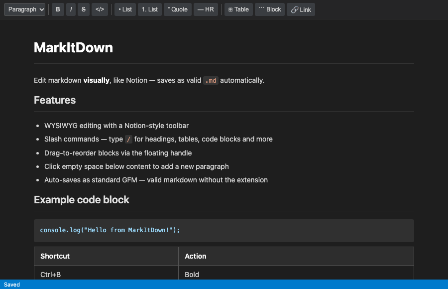

# MarkItDown

> Edit markdown **visually** — like Notion. Saves as valid `.md` automatically.



---

## What it does

MarkItDown replaces the default VS Code markdown text editor with a WYSIWYG editor. You click, type, and format — no raw markdown syntax in your face. When you save, the file is written as standard [GitHub Flavored Markdown](https://github.github.com/gfm/), so anyone opening it without this extension sees a normal, valid `.md` file.

---

## Features

- **Toolbar** — Paragraph/H1–H6 selector, Bold, Italic, Strikethrough, Inline code, Bullet list, Numbered list, Blockquote, Horizontal rule, Table, Code block, Link, Image
- **Slash commands** — Type `/` at the start of a line to open an inline command palette. Filter by typing (e.g. `/table`, `/h2`, `/code`). Navigate with `↑ ↓`, confirm with `Enter`, dismiss with `Escape`
- **Drag to reorder** — Hover any block to reveal a drag handle on the left. Drag it above or below other blocks to reorder
- **Click empty space** — Click anywhere below the last block to create a new paragraph and start typing immediately
- **Auto-save** — Changes are saved 800 ms after you stop typing. The status bar shows `Saved` / `Unsaved changes…`
- **Keyboard shortcuts** — `Ctrl+S` / `Cmd+S` saves immediately; `Ctrl+B` bold; `Ctrl+I` italic
- **Standard output** — The saved file is always valid GFM markdown. Tables, code fences, headings, lists, blockquotes, images, and links all round-trip correctly

---

## Installation

Search **MarkItDown** in the VS Code Extensions sidebar, or install from the terminal:

```bash
code --install-extension KaalaAadmi.markitdown
```

Once installed, open any `.md` or `.markdown` file — it opens in the WYSIWYG editor automatically via **Reopen Editor With → MarkItDown WYSIWYG**.

---

## Switching editors

### Open a file in the plain text editor (one file, one time)

1. Right-click the file tab → **Reopen Editor With…**
2. Select **Text Editor**

### Make the plain text editor your permanent default (disable MarkItDown as default)

Open your VS Code settings (`Ctrl+,` / `Cmd+,`) and add:

```json
"workbench.editorAssociations": {
  "*.md": "default"
}
```

This tells VS Code to use its built-in text editor for all `.md` files. MarkItDown stays installed and available via **Reopen Editor With…** whenever you want it.

### Switch back to MarkItDown as default

Change the setting to:

```json
"workbench.editorAssociations": {
  "*.md": "readmeEditor.wysiwyg"
}
```

Or simply remove the `workbench.editorAssociations` entry entirely — MarkItDown will be offered as an option each time via **Reopen Editor With…**.

---

## Keyboard shortcuts reference

| Shortcut | Action |
| --- | --- |
| `Ctrl+B` / `Cmd+B` | Bold |
| `Ctrl+I` / `Cmd+I` | Italic |
| `Ctrl+S` / `Cmd+S` | Save immediately |
| `/` at line start | Open slash command palette |
| `↑ ↓` in slash menu | Navigate options |
| `Enter` in slash menu | Insert selected block |
| `Escape` in slash menu | Dismiss |
| `Backspace` in slash menu | Delete query character |

---

## Slash commands

Type `/` at the beginning of a line to open the command palette:

| Command | Block type |
| --- | --- |
| `/h1` `/h2` `/h3` | Heading 1 / 2 / 3 |
| `/ul` `/bullet` | Bullet list |
| `/ol` `/numbered` | Numbered list |
| `/quote` | Blockquote |
| `/hr` `/divider` | Horizontal rule |
| `/code` | Code block |
| `/table` | Table (prompts for columns × rows) |
| `/link` | Link |
| `/image` | Image |
| `/text` `/paragraph` | Plain paragraph |

---

## How the file is saved

The editor serializes the DOM back to standard markdown on every save. The output is compatible with GitHub, GitLab, npm, and any markdown renderer. Opening the file in any editor without this extension shows normal markdown syntax.

---

## License

MIT © [KaalaAadmi](https://github.com/KaalaAadmi)
